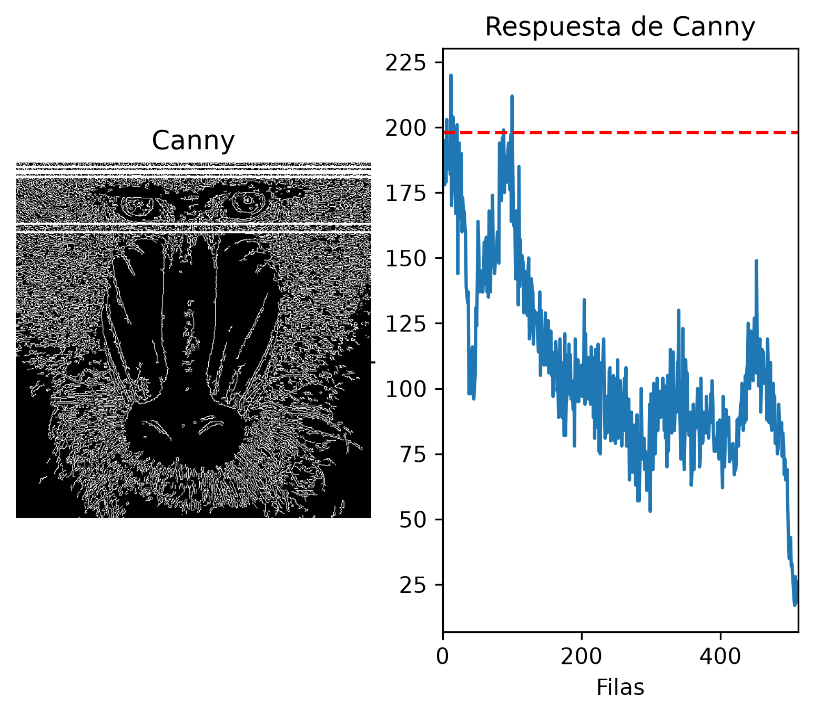
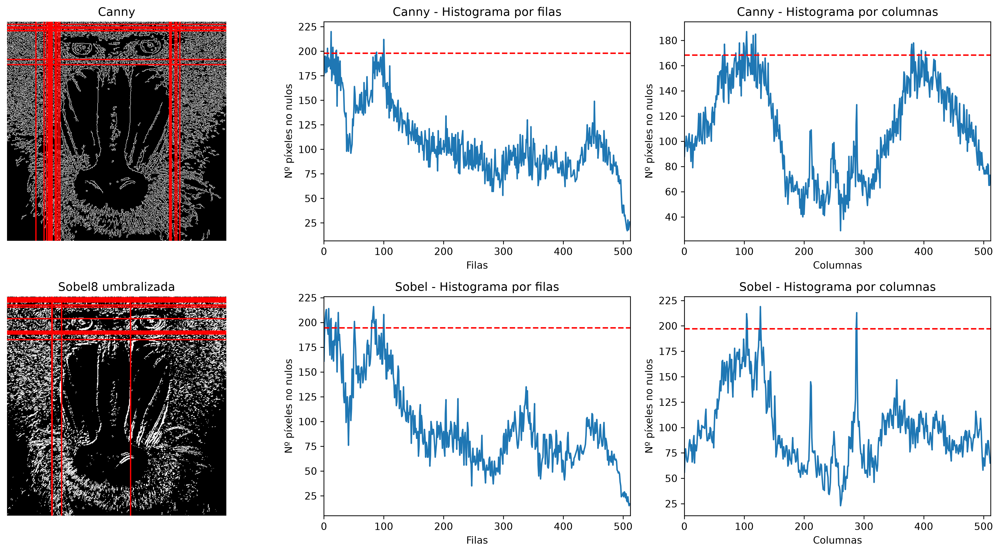
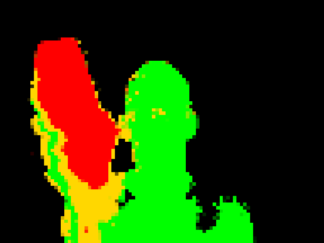
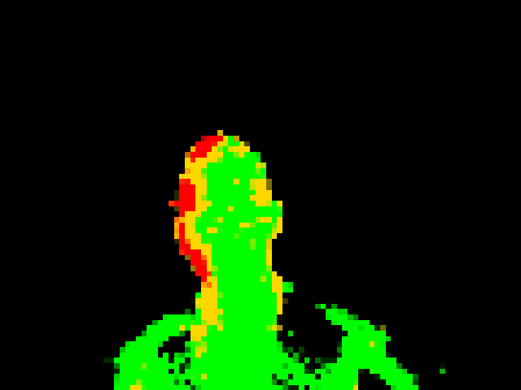

# VC - Práctica 2 - Funciones básicas de OpenCV

## Autor

- Sergio Dámaso Guerra

## Estructura del repositorio

- `VC_P2_SDG.ipynb`: cuaderno con la resolución de las tareas.
- `images/`: imágenes utilizadas en el README y en el cuaderno.
- `README.md`: documentación de la práctica.

## Descripción

Esta práctica tiene como objetivo profundizar en el procesamiento y análisis de imágenes mediante funciones básicas de OpenCV.

Las primeras tareas estudian la distribución de píxeles resultante de diferentes técnicas de detección de bordes, utilizando histogramas por filas y columnas para localizar las zonas de mayor concentración de píxeles. En particular, se comparan los resultados obtenidos mediante Canny y Sobel.

Finalmente, se propone una aplicación en vídeo basada en la detección de cambios entre fotogramas. Para ello se combina la sustracción de fondo mediante MOG2 con la diferencia entre fotogramas consecutivos, utilizando esta información para representar visualmente la intensidad del movimiento.

## Tarea 1 - Histograma

### Objetivo
Analizar la distribución de píxeles blancos por filas de una imagen en escala de grises procesada mediante Canny, identificando aquellas filas cuya cantidad de píxeles blancos supera el 90 % del máximo obtenido.

### Implementación
Se realiza un conteo de los píxeles blancos de cada fila de la imagen resultante de Canny. Posteriormente, se normalizan estos valores respecto al valor máximo y se calcula el umbral correspondiente al 90 % de dicho máximo.

Finalmente, se recorren los valores obtenidos para identificar las filas que cumplen el requisito y se representan tanto en el histograma como sobre la imagen original.

### Resultados

En el histograma y en la imagen resultante se observa una mayor concentración de píxeles de borde en determinadas zonas de la cara del mandril. En particular, destacan las regiones situadas alrededor de los ojos, debido a los cambios de intensidad presentes en sus contornos.

## Tarea 2 - Comparación Canny y Sobel

### Objetivo
Repetir el análisis realizado en la tarea anterior utilizando una imagen procesada mediante Sobel y posteriormente umbralizada y convertida a 8 bits. Se comparan los resultados obtenidos con Sobel y Canny tanto en la distribución de píxeles por filas como por columnas.

### Implementación
Se calcula el histograma de píxeles blancos de las imágenes obtenidas mediante Canny y Sobel. El análisis se realiza en las dos direcciones de la imagen:

Filas: permite localizar regiones horizontales con una elevada concentración de bordes.
Columnas: permite localizar regiones verticales con una elevada concentración de bordes.

Para ambas técnicas se aplican los criterios de selección de la tarea anterior, obteniendo los máximos y las posiciones que superan el umbral establecido.

### Resultados

Se observan concentraciones importantes de píxeles en las zonas superior e inferior de los ojos cuando se analiza por filas, mientras que mediante el análisis por columnas destacan principalmente las regiones laterales del morro.

### Comparación
Con los umbrales seleccionados para cada técnica, Canny produce una mayor cantidad de picos y, en general, picos de mayor magnitud que Sobel. Esto se debe a que los resultados dependen tanto de las características de cada detector como de los umbrales utilizados para obtener las imágenes binarias.

Por lo tanto, la comparación debe interpretarse teniendo en cuenta que los umbrales aplicados a Canny y Sobel condicionan directamente la cantidad de píxeles considerados como bordes.

## Tarea 3 - Propuesta de detección entre frames

### Idea
Detectar el primer plano respecto a un fondo fijo y representar mediante diferentes colores la intensidad del movimiento detectado.

La propuesta busca generar una representación visual del movimiento en la que las zonas que permanecen prácticamente estables aparezcan en verde, las que presentan un movimiento intermedio en amarillo y las que presentan cambios más intensos en rojo.

### Implementación
Se utiliza MOG2 para obtener una máscara del primer plano respecto a un fondo previamente aprendido. Durante una fase inicial, el algoritmo aprende el fondo sin presencia del objeto, tras lo cual se mantiene fijo para evitar que el objeto detectado pase a formar parte del fondo.

Posteriormente, se calcula la diferencia absoluta entre el fotograma actual y el anterior mediante cv2.absdiff(). La diferencia se convierte a escala de grises para obtener una medida de la intensidad del cambio entre ambos fotogramas.

La máscara de MOG2 permite limitar la representación al primer plano, mientras que la diferencia entre fotogramas permite determinar la intensidad del movimiento. En función de esta intensidad se asignan tres colores:

Verde: movimiento de baja intensidad.
Amarillo: movimiento de intensidad media.
Rojo: movimiento de alta intensidad.

Finalmente, la imagen resultante se reduce de tamaño y posteriormente se amplía utilizando INTER_NEAREST. Esto mantiene bloques de píxeles definidos y produce el efecto visual de pixelación.

### Resultados
La representación obtenida permite visualizar simultáneamente la posición del objeto respecto al fondo y las zonas en las que se está produciendo mayor movimiento.
Frames recopilados:

## Ejecución

El cuaderno puede ejecutarse utilizando Python y Jupyter Notebook.

### Dependencias

- Python
- OpenCV
- NumPy
- Matplotlib

No se requieren instalaciones adicionales a las ya usadas en la práctica 1:
mismo enviroment, en mi caso: python 3.11.14

## Fuentes

- Documentación oficial de OpenCV: https://docs.opencv.org/
- Documentación de NumPy: https://numpy.org/doc/
- Documentación de Matplotlib: https://matplotlib.org/stable/
- ChatGPT (OpenAI), utilizado como apoyo puntual para resolver dudas sobre funciones, parámetros y optimización del código.
